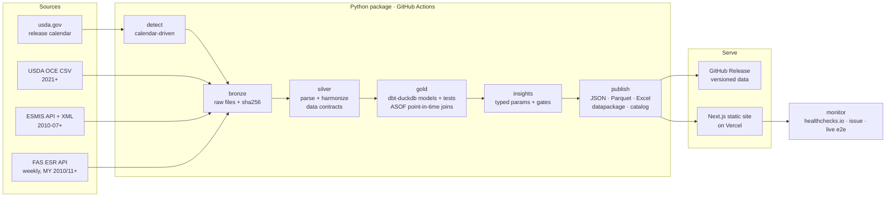

# USDA Reports Dashboard

[](https://github.com/rossi-diego/usda-reports-dashboard/actions/workflows/ci.yml)
[](https://github.com/rossi-diego/usda-reports-dashboard/actions/workflows/release.yml)
[](https://github.com/rossi-diego/usda-reports-dashboard/releases/latest)


[](LICENSE)

**Every USDA WASDE report since July 2010 and every weekly U.S. Export Sales release since
marketing year 2010/11, harmonized into one point-in-time data product — updated automatically
on release day, and turned into the view a trading desk actually needs: what changed, whether
it is tight or loose versus history, and whether export sales are on pace for what USDA itself
projected at the time.**

🔗 **Live site:** https://usda-reports.vercel.app · 📦 **Data:** [latest release](https://github.com/rossi-diego/usda-reports-dashboard/releases/latest)


---

## Why this exists

The USDA's *World Agricultural Supply and Demand Estimates* (WASDE) is the monthly reference
balance sheet for grains, oilseeds, cotton, sugar and livestock. Markets move on it within
seconds of 12:00 ET. What matters is not the snapshot but the **revision**: how USDA's view
of a marketing year changed versus last month, which line drove it, and whether stocks are
tight or loose by historical standards.

USDA publishes isolated monthly files with shifting labels and formats (machine-readable CSV
only since 2021; XML before that). Building the vintage history by hand is tedious and
error-prone. This project does it end to end:

| Question a desk asks | Where it's answered |
|---|---|
| What changed in today's report? | Ranked **headlines** with drivers, streaks and stocks-to-use |
| Why did ending stocks move? | **Waterfall**: beginning stocks, area/yield, imports, use, exports |
| How has USDA's estimate evolved? | **Revision paths** aligned on the crop cycle, vs previous years |
| Is this tight or loose? | **Stocks-to-use history** since 2008/09 with percentile |
| Are export sales on pace for USDA? | **Commitments as % of the WASDE projection public at each ESR release**, vs the same week of the 5 prior years (each against *its* as-of WASDE) |
| Who is buying? | China and **unknown destinations** shares of commitments, vs 5 years |
| Can I get it in Excel / Parquet? | Latest report workbook, per-commodity history, versioned catalogue with `datapackage.json` |

### Reports

| Report | Agency | Cadence (ET) | Source | History | On the site | Status |
|---|---|---|---|---|---|---|
| WASDE | USDA OCE/WAOB | monthly, 12:00 | OCE CSV (2021+) + ESMIS XML | 2010-07 → | [/reports/wasde](https://usda-reports.vercel.app/reports/wasde/) · [commodity pages](https://usda-reports.vercel.app/commodity/soybeans/) | live |
| Export Sales (ESR) | USDA FAS | weekly, Thu 08:30 | FAS ESR API (`api.fas.usda.gov`, api.data.gov key) | MY 2010/11 → | [/reports/export-sales](https://usda-reports.vercel.app/reports/export-sales/) | live |
| NASS crush · Crop Progress · Grain Stocks | USDA NASS | monthly · weekly · quarterly | ESMIS zip CSV | — | placeholder cards | planned |

Release dates, next releases and freshness of every report: [/reports](https://usda-reports.vercel.app/reports/)
(a stale banner appears when a report is older than its cadence plus grace).

### Export Sales on the site


`/reports/export-sales/` has a commodity switcher (soybeans, corn, wheat, soybean meal, soybean
oil), the header numbers (commitments, USDA's export target **as of the release**, next ESR date)
and three chapters:

1. **Pace vs USDA and 5 years**: commitments as % of the WASDE projection that was public each
   week, with the 5 prior marketing years as thin lines, their min–max band and mean. Legend:
   *history = % of the USDA projection at the time*.
2. **Who is buying**: China's share of commitments vs the same week of the 5 prior years,
   always next to the unknown-destinations share, plus the top destinations.
3. **What is still needed**: weekly sales required to reach USDA's projection vs the last
   4-week average (suppressed with fewer than 6 weeks left).

A collapsed *Explore* section holds every week and destination; *Take this report* links the
Parquet/CSV files. The home page adds a **hero line** built from `insights.json` rules
("This week: soybean sales ahead of USDA's pace", neutral fallback otherwise) and one card per
report plus the cross-report E1 card, each with n, a *small sample* chip for 5-year windows and
its source release. Every number on these cards is checked against the JSON by a Playwright
contract test (`web/e2e/contract.spec.ts`), in English and Portuguese.

## Architecture



**Release days.** A scheduled workflow (weekdays, every 30 min, 12–23 UTC) first runs a
light gate that only reads the calendars and the newest manifest: when nothing is due it exits
in seconds without touching any source. **Export Sales** is pulled after Thursday 08:30 ET
(holiday weeks move to Friday); new content becomes an immutable prerelease
`weekly-YYYY-MM-DD`, never marked *Latest*. **WASDE** is polled from 12:00 ET on release day. When the new report appears it ingests it (CSV first, ESMIS XML as
fallback), rebuilds silver and gold deterministically from all bronze files, runs the dbt data
tests, publishes a **versioned GitHub release** (`data-YYYY-MM`) with every file, deploys the
site, and checks the live URL shows the new report. Skipped months (government shutdowns) are
not failures; a report missing 3 days after its scheduled date is.

### Key engineering decisions

| Decision | Why |
|---|---|
| **XML layout learned from the CSV overlap** | The pre-2021 XML does not label commodities or units. Matching 227k cells against the 2021–2025 CSVs learned the layout: 97% of CSV values reproduced exactly (100% of grain/oilseed balance sheets). Older releases fall back to table-level mappings. |
| **Canonical vocabulary, fail on new labels** | `"Ending Stocks, Total"`, `"Ending stocks"` → `ending_stocks`, in reviewable YAML. A label never seen before stops the run instead of silently creating a new series. |
| **Full rebuild every run** | ~850k rows: silver reparse ≈40 s, dbt ≈15 s; no incremental-state bugs. Bronze persists as append-only `bronze-store` shards, each manifest naming the shards it was built from. |
| **dbt-duckdb for gold** | Lineage, documented models and data tests (balance-sheet identity, key uniqueness, plausible stocks-to-use, monotonic WASDE numbers). |
| **Static site + GitHub Releases** | Data changes monthly: no server to run, no cold starts, free hosting, every month's data versioned and downloadable. |
| **Point in time, no look-ahead** | ESR weeks are `ASOF`-joined to the WASDE public at the ESR release instant (`wasde.release_ts_utc <= esr.release_ts_utc`; equal instants count as public). History uses the same rule, so a 5-year band compares like with like. A dbt test (`assert_no_lookahead`) and a same-timestamp boundary unit test guard it. |
| **Every ESR pull is a snapshot** | The FAS API overwrites history. Each pull is stored byte-for-byte in bronze; silver keeps a change log of every vintage (`vintage_quality`: `latest_only` for the backfill, `captured` from launch on). |
| **Insights are parameters, not prose** | Python emits typed `insights.json` (k of n ranks, n always shown, percentile only from n ≥ 10, suppression gates); the site renders the words in EN/PT. |
| **Positive success criteria** | A run succeeds only if the expected report, a plausible row count and the schema all check out — the failure mode that silently broke v1. |

## Data model (gold)

| Model | Grain | What it's for |
|---|---|---|
| `fct_wasde` | report × table × commodity × region × line × MY | The complete harmonized dataset |
| `dim_reports` | report | Publication order, WASDE number, release date |
| `fct_revisions` | series × MY × report | Value, Δ vs last report, Δ vs first projection, `cycle_month` |
| `fct_balance_sheet` | report × table × commodity × region × MY | Wide balance sheet + stocks-to-use |
| `fct_ending_stocks_drivers` | same | Exact decomposition of each ending-stocks revision |
| `fct_changes` | series × MY × report | Seasonal materiality score + revision streaks |
| `dim_release` *(core)* | report_id × release | Every release of every report: UTC release instant, edition, bronze sha256 |
| `dim_calendar` *(core)* | report_id × scheduled date | Upcoming and past release dates, ingested or not |
| `dim_unit`, `dim_commodity` *(seeds)* | unit / commodity | MT conversions (bu, short tons, lb; round-trip tested) and marketing-year start months |
| `int_wasde_asof` *(core)* | commodity × MY × WASDE vintage | U.S. exports, production, ending stocks, crush in native units and MT |
| `fct_export_sales_weekly` | commodity × MY × week × destination | Latest value of weekly exports, accumulated, outstanding, net sales, commitments, next-MY sales (MT) |
| `fct_export_sales_totals` | commodity × MY × week | All destinations, with China and unknown-destination commitments and the 4-week net-sales mean |
| `fct_export_pace` *(cross)* | commodity × MY × week | Commitments ÷ as-of WASDE exports, required weekly sales, 5-prior-MY mean/min/max at the same week |

Models live in `dbt/models/{staging/<report>, marts/core, marts/<report>, marts/cross}` so
every new USDA report adds its own folder. Published ESR and cross marts have enforced dbt
contracts. Every silver table starts with the same **envelope**: `report_id,
release_key, release_ts_utc, edition, source, bronze_sha256, vintage_quality`.

### Downloads (versioned catalogue)

Each data release carries `<report_id>__<dataset>__v<major>` files in Parquet (zstd) and CSV,
listed with rows, bytes and sha256 in `datasets.json`:

| Dataset | Model |
|---|---|
| `wasde__values__v1` | `fct_wasde` (long format, every value) |
| `wasde__balance_sheets__v1` | `fct_balance_sheet` |
| `wasde__revisions__v1` | `fct_revisions` |
| `wasde__changes__v1` | `fct_changes` |
| `export_sales__weekly__v1` | `fct_export_sales_totals` |
| `export_sales__by_country__v1` | `fct_export_sales_weekly` |
| `cross__export_pace__v1` | `fct_export_pace` |

`config/datasets.yaml` maps model → file → schema version. Every release also carries
**`datapackage.json`** (Frictionless; per resource: sha256, bytes, rows, temporal coverage,
latest release, licence and a Table Schema whose descriptions are generated from the dbt
manifest) and **`catalog.json`** (the data tag the site was built from and the release URL of
every file). Field-level contracts of the site JSON: [`docs/DATA_CONTRACT.md`](docs/DATA_CONTRACT.md).

The site's [/data](https://usda-reports.vercel.app/data/) page renders `catalog.json`: grouped
by report (or by commodity), one row per dataset with rows, coverage, latest release, CSV /
Parquet links (site copy when served, otherwise the release asset), schema version and a
copyable sha256, the Excel workbooks, the `datapackage.json` link, the licence and the ESR
vintage note (latest-only before the first capture; tracked since capture after it, with the
latest revision shown and every vintage kept in silver).

`wasde_full.parquet` / `wasde_full.csv.gz` remain as byte-identical aliases of
`wasde__values__v1` for existing users.

**Stocks-to-use:** World and World ex-China = ending stocks ÷ domestic use (trade nets out);
U.S. and countries = ending stocks ÷ (domestic use + exports).

## Quick Start (under 5 minutes)

**Option A — the site with the latest published data (~2 min)**

```bash
git clone https://github.com/rossi-diego/usda-reports-dashboard.git
cd usda-reports-dashboard/web && npm ci && cd ..
make demo            # the live site's data (via its catalog.json), starts http://localhost:3000
```

**Option B — run the pipeline yourself**

```bash
python -m pip install -e ".[dev,dbt]"
export FAS_API_KEY=...  # free api.data.gov key (Export Sales; USDA_PSD_KEY also works)
usda-reports backfill   # every WASDE report since 2010-07 + Export Sales since MY 2010/11
usda-reports run        # silver → gold (dbt) → web data, Excel and the download catalogue
cd web && npm ci && npm run dev
```

**Option C — everything in Docker:** `docker compose up` (pipeline, then site on :3000).

### CLI

| Command | Does |
|---|---|
| `usda-reports backfill [--seed-dir DIR]` | Ingest every missing release of every enabled report into bronze |
| `usda-reports detect [--report export_sales]` | Ingest the latest scheduled release if it's out (WASDE by default; ESR backfills on first run) |
| `usda-reports due [--json]` | Which reports have a release due and missing (calendar only, no network; the workflow gate) |
| `usda-reports esr-verify` · `esr-vocab` | Check the ESR commodity codes/unit against the live lookups · regenerate `config/vocab/countries.yaml` |
| `usda-reports build-info` · `release-tag data\|weekly` · `insights-schema` | `build.json` with per-report freshness · next release tag · JSON Schema of `insights.json` |
| `usda-reports refresh-calendar` | Update `config/calendars/wasde.yaml` from usda.gov |
| `usda-reports build-silver` / `build-gold` / `publish` | Run one layer; `usda-reports run` runs all three |
| `usda-reports pack-shards` / `required-shards` / `unpack-shards DIR` | Persist and restore bronze as append-only `bronze-store` shards |
| `usda-reports latest-key [REPORT]` · `migrate-manifest` | Newest release key · rewrite the manifest as schema v2 |
| `usda-reports learn-xml-layout --seed-dir DIR` | Re-learn the WASDE XML layout from the CSV overlap |

`wasde …` still works as a deprecated alias for one release, and so do `WASDE_*` environment
variables (now `USDA_*`; see `.env.example`).

## Screenshots

| Commodity page | Phone (360–390px) |
|---|---|
|  |  |
| **Data catalogue** (by report or commodity; sha256, schema version, `datapackage.json`) | **Dark mode** |
|  |  |
| **Export Sales, dark** | |
|  | |

## Project structure

```
.github/workflows/   ci.yml · release.yml (gate → detect → build → deploy → verify → release) · keepalive.yml
config/              reports.yaml (registry) · datasets.yaml · calendars/ · contracts/ · vocab/
                     reports/wasde/{mappings.yaml, focus.yaml, xml_layout/} · reports/export_sales/source.yaml
src/usda_reports/
  core/              settings, logging, HTTP, manifest v2, calendars, contracts, vocab, registry
  reports/           ReportSpec base · wasde/ (sources, CSV + XML parsers, XML layout, silver)
                     export_sales/ (ESR API client, ingest, snapshot change-log parser)
  insights/          rules W1–W4, E1–E3 · gates · hero/card selection · typed insights.json schema
  bronze/            raw store + bronze-store delta shards
  silver/            report-agnostic driver + common envelope
  gold.py            runs dbt
  publish/           highlights, web JSON/Parquet, Excel, versioned catalogue, datapackage,
                     catalog.json, Export Sales page JSON, release/tag contract
  cli.py             `usda-reports` command
dbt/                 staging/{wasde,export_sales} · marts/{core,wasde,export_sales,cross} ·
                     seeds (dim_unit, dim_commodity, esr_corrections) · macros (assert_no_lookahead) · tests
web/                 Next.js 16 static site (ECharts, hyparquet, SheetJS), Playwright tests
tests/               unit + integration (dbt + publish on real fixture data)
data/manifest.json   audit trail of every ingested release (schema v2; data lives in releases)
```

## Quality

- **Python:** ruff, mypy, pytest (unit + integration) including an end-to-end dbt + publish
  run on real fixture data, XML-vs-CSV reconciliation, the release/tag contract and Soy Outlook
  compatibility checks. A **parity gate** (`tests/integration/test_parity_wasde.py`, runs when
  the real bronze store is present) rebuilds everything from bronze and proves the result has the
  same rows and sorted-content hash as the published `wasde_full.parquet`.
- **dbt:** schema tests + singular tests (balance identity, unique keys, plausible stocks-to-use,
  monotonic WASDE numbers, complete latest report, no missing report months), enforced contracts
  on the ESR/cross marts, `assert_no_lookahead`, a same-timestamp ASOF boundary unit test,
  non-decreasing ESR accumulated exports (`esr_corrections` seed) and an ESR ↔ WASDE
  reconciliation warning (±10% on completed marketing years).
- **ESR without a key or network in CI:** recorded, trimmed API responses (`tests/fixtures/export_sales/`).
- **Web:** ESLint, TypeScript, Playwright (desktop + mobile): smoke, axe in light and dark on
  every route, 360px no-horizontal-scroll, and a copy-vs-JSON contract test for the hero, the
  home cards and the Export Sales header; re-run against the live site after every deploy.
  Until the first data release that carries `insights.json`, CI overlays a recorded cut-A set
  (`web/e2e/fixtures/cut-a/`) on the downloaded release; afterwards it tests the real files.
- **Charts:** colour palette validated for colour-vision deficiency and contrast in light and dark mode.

## Known limitations

- History starts in July 2010 (earlier reports are PDF/text only).
- Pre-2021 history excludes WASDE's projection-reliability tables and some quarterly
  livestock lines; the U.S. milk table's fat/skim blocks are not fully separated in the XML era.
- Projected prices published as ranges in older reports are stored as the range midpoint.
- No pre-report trade estimates (not public), so "surprise vs. the market" is out of scope.
- Values are as published by USDA (rounded); tiny changes can be rounding.
- Export Sales history before the first weekly capture is `latest_only`: the API returns
  today's revised values for old weeks. Release instants of backfilled weeks follow the weekly
  calendar rule (never earlier than the real publication, so no look-ahead).
- ESR counts sales and shipments reported by exporters; WASDE exports follow Census trade data.
  The two differ (notably soybean oil and some wheat years); the reconciliation test warns, the
  pace insights carry the caveat.

## Author

**Diego Rossi** — Market Risk & Data Engineering · commodity markets, derivatives, agribusiness.

Data: USDA World Agricultural Outlook Board and USDA Foreign Agricultural Service (public
domain). Not affiliated with USDA.
