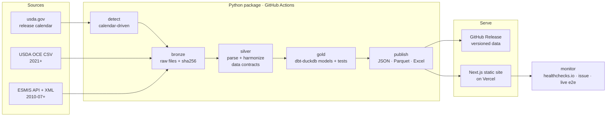
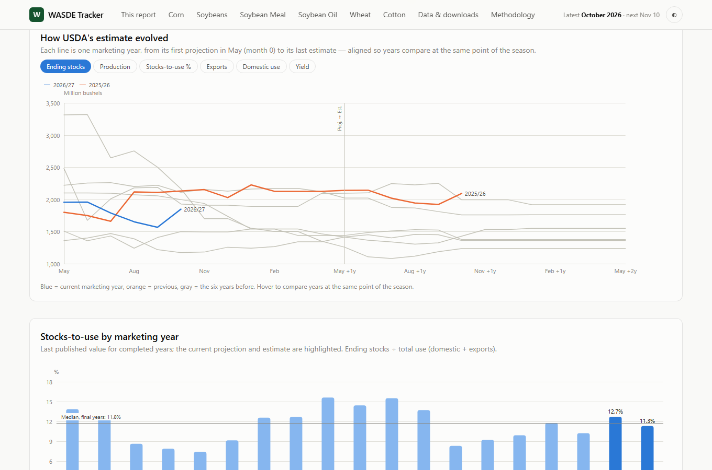

# WASDE Tracker

[](https://github.com/rossi-diego/wasde-monthly-report/actions/workflows/ci.yml)
[](https://github.com/rossi-diego/wasde-monthly-report/actions/workflows/release.yml)
[](https://github.com/rossi-diego/wasde-monthly-report/releases/latest)


[](LICENSE)

**Every USDA WASDE report since July 2010, as one harmonized table — updated automatically
on release day, and turned into the view a trading desk actually needs: what changed, why,
and where fundamentals sit versus history.**

🔗 **Live site:** https://wasde-tracker.vercel.app · 📦 **Data:** [latest release](https://github.com/rossi-diego/wasde-monthly-report/releases/latest)


---

## Why this exists

The USDA's *World Agricultural Supply and Demand Estimates* (WASDE) is the monthly reference
balance sheet for grains, oilseeds, cotton, sugar and livestock. Markets move on it within
seconds of 12:00 ET. What matters is not the snapshot but the **revision**: how USDA's view
of a marketing year changed versus last month, which line drove it, and whether stocks are
tight or loose by historical standards.

USDA publishes isolated monthly files with shifting labels and formats (machine-readable CSV
only since 2021; XML before that). Building the vintage history by hand is tedious and
error-prone. This project does it end to end:

| Question a desk asks | Where it's answered |
|---|---|
| What changed in today's report? | Ranked **headlines** with drivers, streaks and stocks-to-use |
| Why did ending stocks move? | **Waterfall**: beginning stocks, area/yield, imports, use, exports |
| How has USDA's estimate evolved? | **Revision paths** aligned on the crop cycle, vs previous years |
| Is this tight or loose? | **Stocks-to-use history** since 2008/09 with percentile |
| Can I get it in Excel? | Latest report workbook, per-commodity history, filtered exports |

## Architecture



**Monthly flow.** A scheduled workflow reads the official release calendar and polls from
12:00 ET on release day. When the new report appears it ingests it (CSV first, ESMIS XML as
fallback), rebuilds silver and gold deterministically from all bronze files, runs the dbt data
tests, publishes a **versioned GitHub release** (`data-YYYY-MM`) with every file, deploys the
site, and checks the live URL shows the new report. Skipped months (government shutdowns) are
not failures; a report missing 3 days after its scheduled date is.

### Key engineering decisions

| Decision | Why |
|---|---|
| **XML layout learned from the CSV overlap** | The pre-2021 XML does not label commodities or units. Matching 227k cells against the 2021–2025 CSVs learned the layout: 97% of CSV values reproduced exactly (100% of grain/oilseed balance sheets). Older releases fall back to table-level mappings. |
| **Canonical vocabulary, fail on new labels** | `"Ending Stocks, Total"`, `"Ending stocks"` → `ending_stocks`, in reviewable YAML. A label never seen before stops the run instead of silently creating a new series. |
| **Full rebuild every run** | ~850k rows rebuild in under a minute; no incremental-state bugs. |
| **dbt-duckdb for gold** | Lineage, documented models and data tests (balance-sheet identity, key uniqueness, plausible stocks-to-use, monotonic WASDE numbers). |
| **Static site + GitHub Releases** | Data changes monthly: no server to run, no cold starts, free hosting, every month's data versioned and downloadable. |
| **Positive success criteria** | A run succeeds only if the expected report, a plausible row count and the schema all check out — the failure mode that silently broke v1. |

## Data model (gold)

| Model | Grain | What it's for |
|---|---|---|
| `fct_wasde` | report × table × commodity × region × line × MY | The complete harmonized dataset |
| `dim_reports` | report | Publication order, WASDE number, release date |
| `fct_revisions` | series × MY × report | Value, Δ vs last report, Δ vs first projection, `cycle_month` |
| `fct_balance_sheet` | report × table × commodity × region × MY | Wide balance sheet + stocks-to-use |
| `fct_ending_stocks_drivers` | same | Exact decomposition of each ending-stocks revision |
| `fct_changes` | series × MY × report | Seasonal materiality score + revision streaks |

**Stocks-to-use:** World and World ex-China = ending stocks ÷ domestic use (trade nets out);
U.S. and countries = ending stocks ÷ (domestic use + exports).

## Quick Start (under 5 minutes)

**Option A — the site with the latest published data (~2 min)**

```bash
git clone https://github.com/rossi-diego/wasde-monthly-report.git
cd wasde-monthly-report/web && npm ci && cd ..
make demo            # downloads the latest data release, starts http://localhost:3000
```

**Option B — run the pipeline yourself**

```bash
python -m pip install -e ".[dev,dbt]"
wasde backfill       # every report since 2010-07 (~10 min the first time)
wasde run            # silver → gold (dbt) → web data + Excel files in data/publish
cd web && npm ci && npm run dev
```

**Option C — everything in Docker:** `docker compose up` (pipeline, then site on :3000).

### CLI

| Command | Does |
|---|---|
| `wasde backfill [--seed-dir DIR]` | Ingest every missing report into bronze |
| `wasde detect` | Ingest the latest scheduled report if it's out (used by the scheduler) |
| `wasde refresh-calendar` | Update `config/release_calendar.yaml` from usda.gov |
| `wasde build-silver` / `build-gold` / `publish` | Run one layer; `wasde run` runs all three |
| `wasde learn-xml-layout --seed-dir DIR` | Re-learn the XML layout from the CSV overlap |

## Screenshots

| Commodity page | Revision paths & stocks-to-use |
|---|---|
|  |  |
| **Data & downloads** | **Dark mode** |
|  |  |

## Project structure

```
.github/workflows/   ci.yml · release.yml (detect → build → release → deploy → verify) · keepalive.yml
config/              mappings.yaml · focus.yaml (commodities, highlight rules) · release_calendar.yaml · xml_layout/
src/wasde/
  sources/           USDA CSV, ESMIS API, release calendar
  bronze.py          raw store, manifest, backfill, archive
  silver/            CSV + XML parsers, learned XML layout, harmonization, contracts
  gold.py            runs dbt
  publish/           highlights, web JSON/Parquet, Excel workbooks
  cli.py             `wasde` command
dbt/                 staging + marts models, schema docs, data tests
web/                 Next.js 16 static site (ECharts, hyparquet, SheetJS), Playwright tests
tests/               unit + integration (dbt + publish on real fixture data)
data/manifest.json   audit trail of every ingested report (data itself lives in releases)
```

## Quality

- **Python:** ruff, mypy, 83 pytest tests (90% coverage) including an end-to-end dbt + publish
  run on real fixture data and XML-vs-CSV reconciliation.
- **dbt:** schema tests + singular tests (balance identity, unique keys, plausible stocks-to-use,
  monotonic WASDE numbers, complete latest report, no missing report months).
- **Web:** ESLint, TypeScript, Playwright smoke tests (desktop + mobile), re-run against the live
  site after every deploy.
- **Charts:** colour palette validated for colour-vision deficiency and contrast in light and dark mode.

## Known limitations

- History starts in July 2010 (earlier reports are PDF/text only).
- Pre-2021 history excludes WASDE's projection-reliability tables and some quarterly
  livestock lines; the U.S. milk table's fat/skim blocks are not fully separated in the XML era.
- Projected prices published as ranges in older reports are stored as the range midpoint.
- No pre-report trade estimates (not public), so "surprise vs. the market" is out of scope.
- Values are as published by USDA (rounded); tiny changes can be rounding.

## Author

**Diego Rossi** — Market Risk & Data Engineering · commodity markets, derivatives, agribusiness.

Data: USDA World Agricultural Outlook Board (public domain). Not affiliated with USDA.
