# USDA Reports Dashboard

[](https://github.com/rossi-diego/usda-reports-dashboard/actions/workflows/ci.yml)
[](https://github.com/rossi-diego/usda-reports-dashboard/actions/workflows/release.yml)
[](https://github.com/rossi-diego/usda-reports-dashboard/releases/latest)


[](LICENSE)

**Five USDA reports — every WASDE since July 2010, every weekly Export Sales release since
marketing year 2010/11, the monthly NASS soybean crush since October 2015, the weekly NASS Crop
Progress since 2010 and the quarterly NASS Grain Stocks since 2010 — harmonized into one
point-in-time data product, updated automatically on release day, and turned into the view a
trading desk actually needs: what changed, whether it is tight or loose versus history, whether
sales and crush are on pace for what USDA itself projected at the time, how the crop looks and
whether stocks surprised USDA. In English and Brazilian Portuguese.**

🔗 **Live site:** https://usda-reports.vercel.app · 📦 **Data:** [latest release](https://github.com/rossi-diego/usda-reports-dashboard/releases/latest)

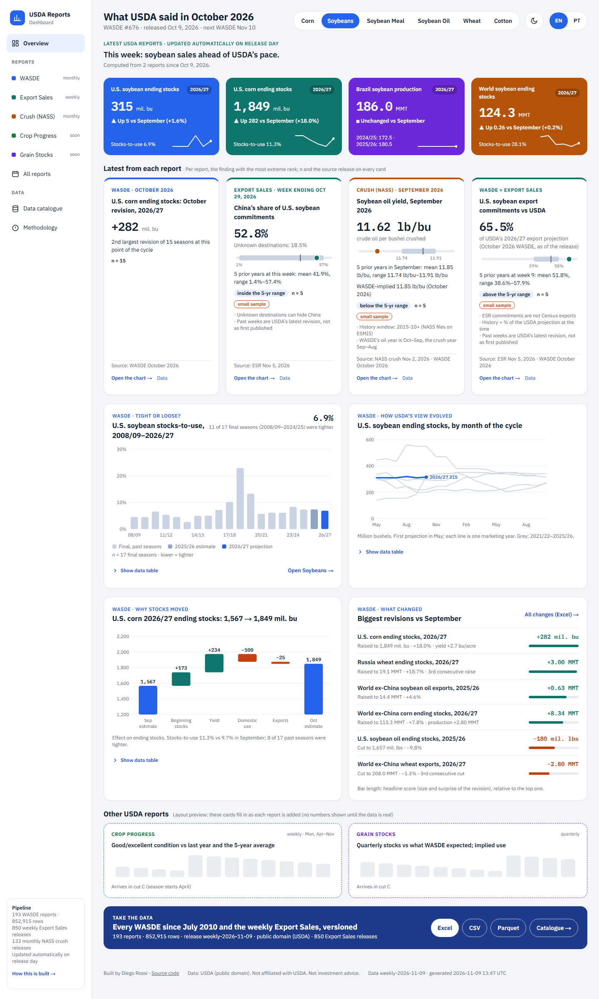

## 30-second tour

1. **[Home](https://usda-reports.vercel.app/)** — a one-screen front door, top-anchored: one
   solid tile per report right under the title (a number, **n**, a *small sample* chip where it
   applies and the source release; values and footers on one line across the row), then two
   card rows on one 7 | 5 grid: the lead story (this week's sentence with its evidence — the only
   chart on the page, with **n** and the 5-year range) beside the top 3 WASDE revisions, and the
   downloads beside the commodity pages. Crop Progress is green, Grain Stocks violet; off-season
   (December–March) Crop Progress steps aside. Below 1024px the sidebar becomes a 56px app bar
   with a *Menu* drawer.
2. **Open a tile** — it lands on the report chapter it comes from, e.g.
   [Crop Progress](https://usda-reports.vercel.app/reports/crop-progress/) (condition vs last year
   and 5 years, stage pace vs NASS's own 5-yr average, season state) or
   [Grain Stocks](https://usda-reports.vercel.app/reports/grain-stocks/) (stocks vs the WASDE
   public at the release, implied use, on-farm share).
3. **One commodity, every report** —
   [/commodities/soybeans](https://usda-reports.vercel.app/commodities/soybeans/) puts the latest
   WASDE, Export Sales, crush, Crop Progress and Grain Stocks numbers on one page, each linked to
   its chapter and its files.
4. **Take the data** — [/data](https://usda-reports.vercel.app/data/): every dataset as Parquet/CSV
   with sha256, schema version and `datapackage.json`; vintages on GitHub Releases.
5. **Switch to PT** (top right) — every string, date and number (1.234,5) follows; the
   [methodology](https://usda-reports.vercel.app/methodology/) states every formula in both
   languages.

---

## Why this exists

The USDA's *World Agricultural Supply and Demand Estimates* (WASDE) is the monthly reference
balance sheet for grains, oilseeds, cotton, sugar and livestock. Markets move on it within
seconds of 12:00 ET. What matters is not the snapshot but the **revision**: how USDA's view
of a marketing year changed versus last month, which line drove it, and whether stocks are
tight or loose by historical standards.

USDA publishes isolated monthly files with shifting labels and formats (machine-readable CSV
only since 2021; XML before that). Building the vintage history by hand is tedious and
error-prone. This project does it end to end:

| Question a desk asks | Where it's answered |
|---|---|
| What changed in today's report? | Ranked **headlines** with drivers, streaks and stocks-to-use |
| Why did ending stocks move? | **Waterfall**: beginning stocks, area/yield, imports, use, exports |
| How has USDA's estimate evolved? | **Revision paths** aligned on the crop cycle, vs previous years |
| Is this tight or loose? | **Stocks-to-use history** since 2008/09 with percentile |
| Are export sales on pace for USDA? | **Commitments as % of the WASDE projection public at each ESR release**, vs the same week of the 5 prior years (each against *its* as-of WASDE) |
| Who is buying? | China and **unknown destinations** shares of commitments, vs 5 years |
| Is the crush on pace for USDA? | **NASS crush to date as % of the WASDE crush projection public when NASS printed the month**, what is still needed per month, and the oil yield per bushel vs 5 years and vs the WASDE-implied yield |
| Is the crop ahead or behind, and in what shape? | **Crop Progress**: stage vs NASS's own published 5-yr average (C2), good-to-excellent vs NASS's previous year and an own 5-season comparison (C1), condition index 1–5 (C3); "season closed" off-season |
| Did stocks surprise USDA? | **Grain Stocks** vs the WASDE ending stocks public at the release (G1, ranked since 2010), implied disappearance (G2) and on-farm share (G3) |
| Can I get it in Excel / Parquet? | Latest report workbook, per-commodity history, versioned catalogue with `datapackage.json` |

### Reports

| Report | Agency | Cadence (ET) | Source | History | On the site | Status |
|---|---|---|---|---|---|---|
| WASDE | USDA OCE/WAOB | monthly, 12:00 | OCE CSV (2021+) + ESMIS XML | 2010-07 → | [/reports/wasde](https://usda-reports.vercel.app/reports/wasde/) · [commodity pages](https://usda-reports.vercel.app/commodity/soybeans/) | live |
| Export Sales (ESR) | USDA FAS | weekly, Thu 08:30 | FAS ESR API (`api.fas.usda.gov`, api.data.gov key) | MY 2010/11 → | [/reports/export-sales](https://usda-reports.vercel.app/reports/export-sales/) | live |
| Fats & Oils: soybean crush | USDA NASS | monthly, ~1st business day 15:00 | ESMIS `FatsOils` → release zip → `cafo_all_tables.csv` (no key) | 2015-10 → (ESMIS limit) | [/reports/oilseed-crush](https://usda-reports.vercel.app/reports/oilseed-crush/) | live |
| Crop Progress (corn, soybeans, winter/spring wheat; national) | USDA NASS | weekly, Mon 16:00 (Apr–Nov; holiday → Tue) | ESMIS `CropProg` → release zip → `prog_all_tables.csv` (no key) | 2010-06 → | [/reports/crop-progress](https://usda-reports.vercel.app/reports/crop-progress/) | live (cut C) |
| Grain Stocks (corn, soybeans, wheat; by position) | USDA NASS | quarterly, 12:00 | ESMIS `GraiStoc` → release zip → `grst_all_tables.csv` (no key) | 2010-06 → | [/reports/grain-stocks](https://usda-reports.vercel.app/reports/grain-stocks/) | live (cut C) |

Commodity pages combining every report: [/commodities/soybeans](https://usda-reports.vercel.app/commodities/soybeans/) ·
[/commodities/corn](https://usda-reports.vercel.app/commodities/corn/).

Release dates, next releases and freshness of every report: [/reports](https://usda-reports.vercel.app/reports/)
(a stale banner appears when a report is older than its cadence plus grace).

### Export Sales on the site

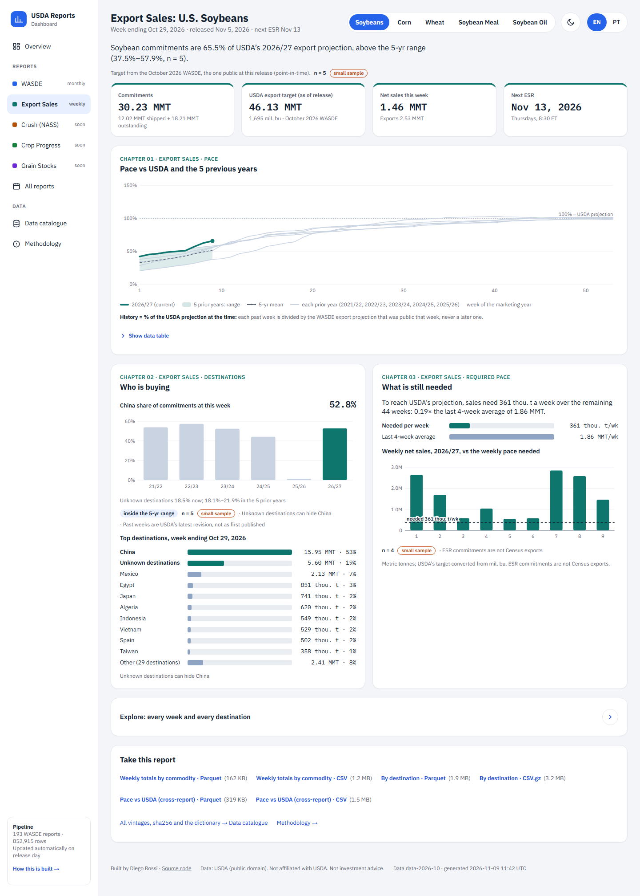

`/reports/export-sales/` has a commodity switcher (soybeans, corn, wheat, soybean meal, soybean
oil), the header numbers (commitments, USDA's export target **as of the release**, next ESR date)
and three chapters:

1. **Pace vs USDA and 5 years**: commitments as % of the WASDE projection that was public each
   week, with the 5 prior marketing years as thin lines, their min–max band and mean. Legend:
   *history = % of the USDA projection at the time*.
2. **Who is buying**: China's share of commitments vs the same week of the 5 prior years,
   always next to the unknown-destinations share, plus the top destinations.
3. **What is still needed**: weekly sales required to reach USDA's projection vs the last
   4-week average (suppressed with fewer than 6 weeks left).

A collapsed *Explore* section holds every week and destination; *Take this report* links the
Parquet/CSV files. The home page shows one tile per report, each with n, a *small sample* chip
for 5-year windows and its source release, then a **lead card** whose heading is built from
`insights.json` rules ("Soybean sales ahead of USDA's pace.", neutral fallback otherwise) over
the cross-report E1 evidence. Every number on these cards is checked against the JSON by a Playwright
contract test (`web/e2e/contract.spec.ts`), in English and Portuguese.

### Soybean crush on the site

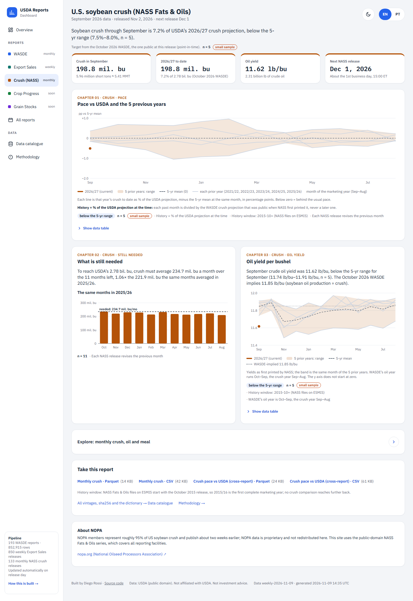

`/reports/oilseed-crush/` reads the monthly NASS *Fats and Oils: Oilseed Crushings, Production,
Consumption and Stocks* report (released about the first business day of each month at 15:00 ET
and covering the month two months earlier). Header numbers: the newest month's crush (bushels,
short tons and metric tonnes), the marketing-year-to-date crush against USDA's crush projection
**as of the release**, the oil yield and the next NASS release date. Three chapters:

1. **Pace vs USDA and 5 years (F1)**: crush to date as % of the WASDE crush projection that was
   public when NASS first printed each month, plotted as percentage points vs the 5-yr mean at
   that month, with the 5 prior marketing years and their band (cumulative shares are nearly
   linear, so the raw 0–100% view hides the gap).
2. **What is still needed (F2)**: monthly crush required to reach USDA vs the same remaining
   months of last year (suppressed with fewer than 5 months left: n = months compared, min n = 5).
3. **Oil yield (F3)**: crude oil lb per bushel vs the same month of the 5 prior years and vs the
   WASDE-implied yield (soybean oil production ÷ crush).

Units are exactly as NASS prints them (tons = short tons; oil in 1,000 lb; bushels = short tons
× 33.3333). The marketing year runs September–August. **History window: 2015-10+** (ESMIS holds
NASS files from the October 2015 release only, so 2015/16 is the first complete year and no
crush comparison reaches further back). Each release zip is stored byte-for-byte and every
printed value (year-ago, revised previous month, current month) is kept with the release that
printed it, so a year-to-date sum always uses the NASS vintages public at that instant.

> **NOPA.** NOPA members represent roughly 95% of US soybean crush and publish about two weeks
> earlier; NOPA data is proprietary and not redistributed here. This site uses the
> public-domain NASS Fats & Oils series, which covers all reporting facilities.
> ([nopa.org](https://www.nopa.org/); licensing evidence in [`docs/DATA_LICENSES.md`](docs/DATA_LICENSES.md).)

### Crop Progress on the site

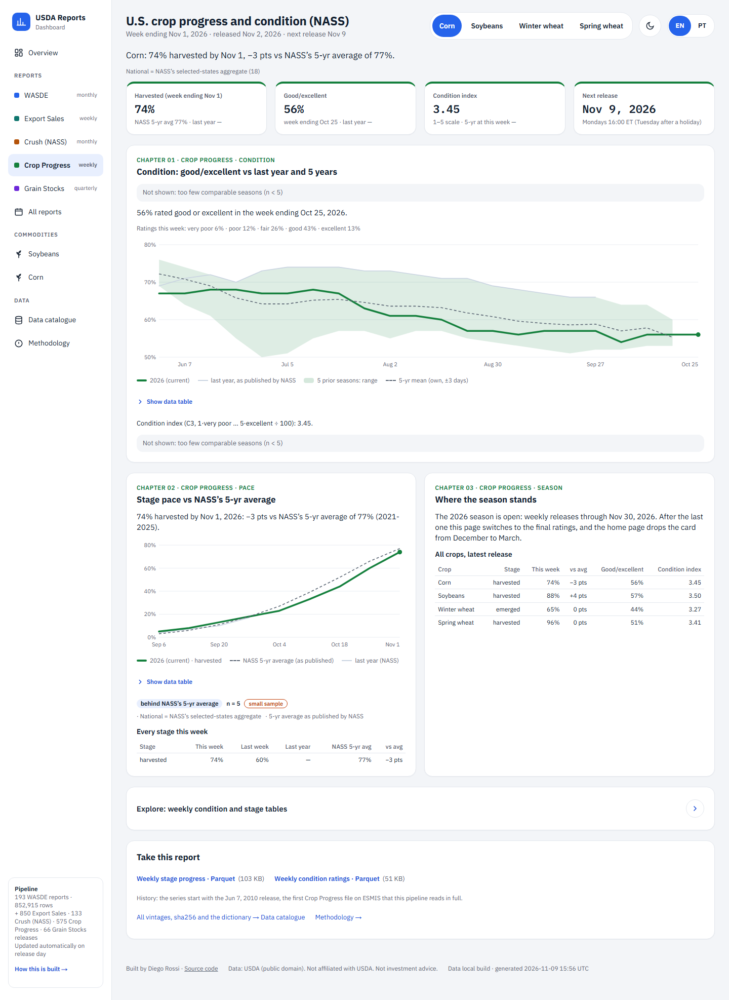

`/reports/crop-progress/` has a crop switcher (corn, soybeans, winter wheat, spring wheat; the
national figure is NASS's own selected-states aggregate), the header numbers (stage in progress,
good/excellent, condition index, next Monday release) and three chapters:

1. **Condition (C1, C3)**: good + excellent by week against NASS's published previous-year value
   and the 5 prior seasons at the nearest week by day of year (±3 days; NASS publishes no 5-yr
   condition average, so that band is computed here and labelled so). The condition index
   CI = (1·VP + 2·P + 3·F + 4·G + 5·E) ÷ 100 sits under it.
2. **Stage pace (C2)**: the stage in progress against **NASS's own published 5-yr average**, used
   exactly as published.
3. **Season state**: in season, every crop's latest stage and rating; after the last scheduled
   release, "Season closed: final GE X% vs 5-yr Y%" with the final ratings of the 5 prior seasons.
   C2/C3 are then suppressed, the report reads *off-season* (not stale) and the home card is
   hidden December–March. Both states are tested on a frozen-clock fixture
   (`web/e2e/fixtures/offseason`).

### Grain Stocks on the site

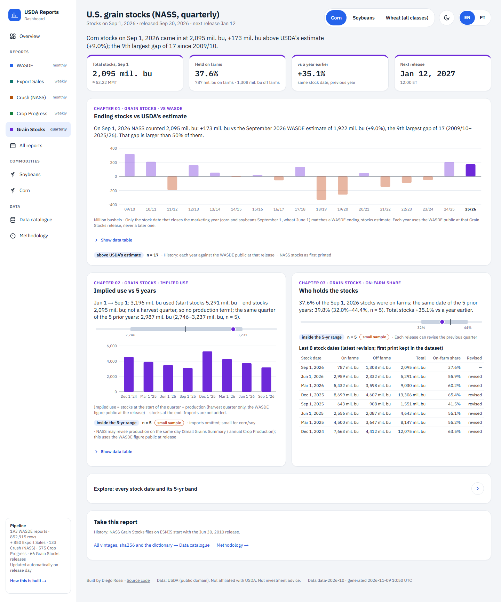

`/reports/grain-stocks/` (corn, soybeans, wheat) shows total, on-farm and year-on-year stocks and:

1. **Stocks vs USDA (G1)**: only for the stock date that closes the marketing year (corn and
   soybeans September 1, wheat June 1): NASS first print minus the WASDE ending stocks public at
   the release, in mil. bu and %, ranked by size since 2010 ("k-th largest of n"; a percentile only
   from n ≥ 10).
2. **Implied use (G2)**: start stocks + production (harvest quarter only, the WASDE figure public
   at the release) − end stocks, vs the same quarter of 5 years. Caveats, verbatim: *imports
   omitted; small for corn/soy* and *NASS may revise production on the same day (Small Grains
   Summary / annual Crop Production); this uses the WASDE figure public at release*.
3. **On-farm share (G3)** vs the same date of 5 years.

### One commodity, every report

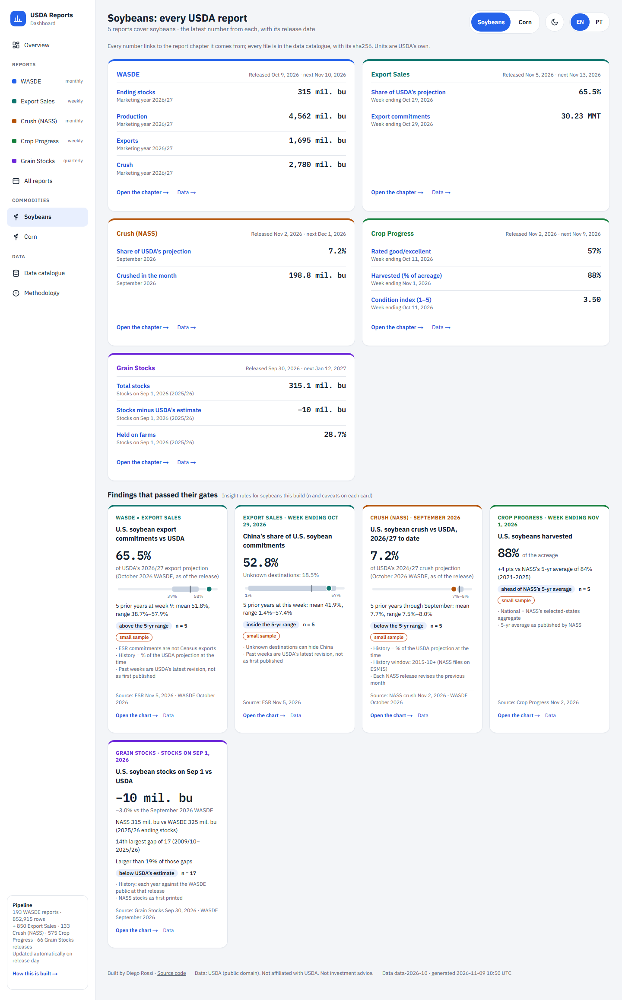

`/commodities/soybeans/` and `/commodities/corn/` (in the sidebar under *Commodities*) list the
latest number of every report that covers the commodity — WASDE balance sheet, Export Sales
commitments and pace, crush, Crop Progress, Grain Stocks — with its release date, a link to the
exact chapter and the Parquet files, followed by one passing finding per report. The home page
links to them ("Explore by commodity", with the reports that cover each one).

### Portuguese (pt-BR)

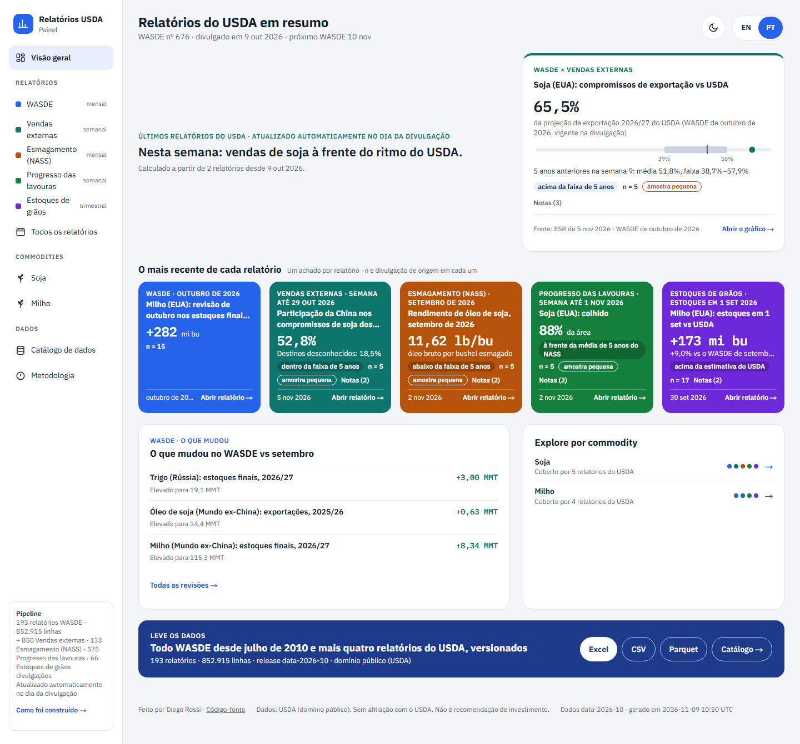

Every string exists in both languages (`web/lib/i18n.ts` types PT as a complete record, so a
missing translation fails the build), numbers and dates follow the language (1.234,5 · 9 nov 2026),
and the methodology is written in both. Playwright runs axe on every route in EN and PT, light
and dark, and checks that the PT pages carry no English UI copy.

## Architecture

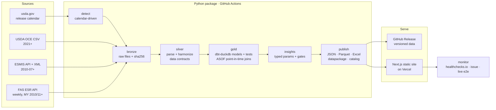

**Release days.** A scheduled workflow (weekdays, every 30 min, 12–23 UTC) first runs a
light gate that only reads the calendars and the newest manifest: when nothing is due it exits
in seconds without touching any source. **Export Sales** is pulled after Thursday 08:30 ET
(holiday weeks move to Friday); new content becomes an immutable prerelease
`weekly-YYYY-MM-DD`, never marked *Latest*. **NASS crush** is detected from 15:00 ET on its
release day by listing ESMIS (page 0, the newest releases); a build whose only new content is
crush data publishes the same kind of immutable `weekly-YYYY-MM-DD` prerelease (named after the
build day; `.2`, `.3`… when that tag exists), so `data-*` stays *Latest* for Soy Outlook and
other users. Export Sales and crush are each isolated: a failing source keeps its last good
data, is flagged in `build.json` and opens the alert issue, and never blocks WASDE. **WASDE** is polled from 12:00 ET on release day. When the new report appears it ingests it (CSV first, ESMIS XML as
fallback), rebuilds silver and gold deterministically from all bronze files, runs the dbt data
tests, publishes a **versioned GitHub release** (`data-YYYY-MM`) with every file, deploys the
site, and checks the live URL shows the new report. Skipped months (government shutdowns) are
not failures; a report missing 3 days after its scheduled date is.

### Key engineering decisions

| Decision | Why |
|---|---|
| **XML layout learned from the CSV overlap** | The pre-2021 XML does not label commodities or units. Matching 227k cells against the 2021–2025 CSVs learned the layout: 97% of CSV values reproduced exactly (100% of grain/oilseed balance sheets). Older releases fall back to table-level mappings. |
| **Canonical vocabulary, fail on new labels** | `"Ending Stocks, Total"`, `"Ending stocks"` → `ending_stocks`, in reviewable YAML. A label never seen before stops the run instead of silently creating a new series. |
| **Full rebuild every run** | ~850k rows: silver reparse ≈40 s, dbt ≈15 s; no incremental-state bugs. Bronze persists as append-only `bronze-store` shards, each manifest naming the shards it was built from. |
| **dbt-duckdb for gold** | Lineage, documented models and data tests (balance-sheet identity, key uniqueness, plausible stocks-to-use, monotonic WASDE numbers). |
| **Static site + GitHub Releases** | Data changes monthly: no server to run, no cold starts, free hosting, every month's data versioned and downloadable. |
| **Point in time, no look-ahead** | ESR weeks are `ASOF`-joined to the WASDE public at the ESR release instant (`wasde.release_ts_utc <= esr.release_ts_utc`; equal instants count as public). History uses the same rule, so a 5-year band compares like with like. A dbt test (`assert_no_lookahead`) and a same-timestamp boundary unit test guard it. |
| **Every ESR pull is a snapshot** | The FAS API overwrites history. Each pull is stored byte-for-byte in bronze; silver keeps a change log of every vintage (`vintage_quality`: `latest_only` for the backfill, `captured` from launch on). |
| **Insights are parameters, not prose** | Python emits typed `insights.json` (k of n ranks, n always shown, percentile only from n ≥ 10, suppression gates); the site renders the words in EN/PT. |
| **Positive success criteria** | A run succeeds only if the expected report, a plausible row count and the schema all check out — the failure mode that silently broke v1. |

## Data model (gold)

| Model | Grain | What it's for |
|---|---|---|
| `fct_wasde` | report × table × commodity × region × line × MY | The complete harmonized dataset |
| `dim_reports` | report | Publication order, WASDE number, release date |
| `fct_revisions` | series × MY × report | Value, Δ vs last report, Δ vs first projection, `cycle_month` |
| `fct_balance_sheet` | report × table × commodity × region × MY | Wide balance sheet + stocks-to-use |
| `fct_ending_stocks_drivers` | same | Exact decomposition of each ending-stocks revision |
| `fct_changes` | series × MY × report | Seasonal materiality score + revision streaks |
| `dim_release` *(core)* | report_id × release | Every release of every report: UTC release instant, edition, bronze sha256 |
| `dim_calendar` *(core)* | report_id × scheduled date | Upcoming and past release dates, ingested or not |
| `dim_unit`, `dim_commodity` *(seeds)* | unit / commodity | MT conversions (bu, short tons, lb; round-trip tested) and marketing-year start months |
| `int_wasde_asof` *(core)* | commodity × MY × WASDE vintage | U.S. exports, production, ending stocks, crush in native units and MT |
| `fct_export_sales_weekly` | commodity × MY × week × destination | Latest value of weekly exports, accumulated, outstanding, net sales, commitments, next-MY sales (MT) |
| `fct_export_sales_totals` | commodity × MY × week | All destinations, with China and unknown-destination commitments and the 4-week net-sales mean |
| `fct_export_pace` *(cross)* | commodity × MY × week | Commitments ÷ as-of WASDE exports, required weekly sales, 5-prior-MY mean/min/max at the same week |
| `fct_soy_crush_monthly` | month | NASS soybeans crushed (short tons, bushels), crude oil and meal produced, oil and meal yield per bushel; latest revision with the release that first printed the month |
| `fct_crush_pace` *(cross)* | MY × month | At the instant NASS first printed the month: crush to date (vintages public then) ÷ as-of WASDE crush, required monthly crush, oil yield vs the WASDE-implied yield, 5-prior-MY band |

Models live in `dbt/models/{staging/<report>, marts/core, marts/<report>, marts/cross}` so
every new USDA report adds its own folder. Published ESR and cross marts have enforced dbt
contracts. Every silver table starts with the same **envelope**: `report_id,
release_key, release_ts_utc, edition, source, bronze_sha256, vintage_quality`.

### Downloads (versioned catalogue)

Each data release carries `<report_id>__<dataset>__v<major>` files in Parquet (zstd) and CSV,
listed with rows, bytes and sha256 in `datasets.json`:

| Dataset | Model |
|---|---|
| `wasde__values__v1` | `fct_wasde` (long format, every value) |
| `wasde__balance_sheets__v1` | `fct_balance_sheet` |
| `wasde__revisions__v1` | `fct_revisions` |
| `wasde__changes__v1` | `fct_changes` |
| `export_sales__weekly__v1` | `fct_export_sales_totals` |
| `export_sales__by_country__v1` | `fct_export_sales_weekly` |
| `cross__export_pace__v1` | `fct_export_pace` |
| `oilseed_crush__monthly__v1` | `fct_soy_crush_monthly` |
| `cross__crush_pace__v1` | `fct_crush_pace` |

`config/datasets.yaml` maps model → file → schema version. Every release also carries
**`datapackage.json`** (Frictionless; per resource: sha256, bytes, rows, temporal coverage,
latest release, licence and a Table Schema whose descriptions are generated from the dbt
manifest) and **`catalog.json`** (the data tag the site was built from and the release URL of
every file). Field-level contracts of the site JSON: [`docs/DATA_CONTRACT.md`](docs/DATA_CONTRACT.md).

The site's [/data](https://usda-reports.vercel.app/data/) page renders `catalog.json`: grouped
by report (or by commodity), one row per dataset with rows, coverage, latest release, CSV /
Parquet links (site copy when served, otherwise the release asset), schema version and a
copyable sha256, the Excel workbooks, the `datapackage.json` link, the licence and the ESR
vintage note (latest-only before the first capture; tracked since capture after it, with the
latest revision shown and every vintage kept in silver).

`wasde_full.parquet` / `wasde_full.csv.gz` remain as byte-identical aliases of
`wasde__values__v1` for existing users.

**Stocks-to-use:** World and World ex-China = ending stocks ÷ domestic use (trade nets out);
U.S. and countries = ending stocks ÷ (domestic use + exports).

## Quick Start (under 5 minutes)

**Option A — the site with the latest published data (~2 min)**

```bash
git clone https://github.com/rossi-diego/usda-reports-dashboard.git
cd usda-reports-dashboard/web && npm ci && cd ..
make demo            # the live site's data (via its catalog.json), starts http://localhost:3000
```

**Option B — run the pipeline yourself**

```bash
python -m pip install -e ".[dev,dbt]"
export FAS_API_KEY=...  # free api.data.gov key (Export Sales; USDA_PSD_KEY also works)
usda-reports backfill   # every WASDE report since 2010-07 + Export Sales since MY 2010/11
usda-reports run        # silver → gold (dbt) → web data, Excel and the download catalogue
cd web && npm ci && npm run dev
```

**Option C — everything in Docker:** `docker compose up` (pipeline, then site on :3000).

### CLI

| Command | Does |
|---|---|
| `usda-reports backfill [--seed-dir DIR]` | Ingest every missing release of every enabled report into bronze |
| `usda-reports detect [--report export_sales]` | Ingest the latest scheduled release if it's out (WASDE by default; ESR backfills on first run) |
| `usda-reports due [--json]` | Which reports have a release due and missing (calendar only, no network; the workflow gate) |
| `usda-reports esr-verify` · `esr-vocab` | Check the ESR commodity codes/unit against the live lookups · regenerate `config/vocab/countries.yaml` |
| `usda-reports build-info` · `release-tag data\|weekly` · `insights-schema` | `build.json` with per-report freshness · next release tag · JSON Schema of `insights.json` |
| `usda-reports refresh-calendar` | Update `config/calendars/wasde.yaml` from usda.gov |
| `usda-reports build-silver` / `build-gold` / `publish` | Run one layer; `usda-reports run` runs all three |
| `usda-reports pack-shards` / `required-shards` / `unpack-shards DIR` | Persist and restore bronze as append-only `bronze-store` shards |
| `usda-reports latest-key [REPORT]` · `migrate-manifest` | Newest release key · rewrite the manifest as schema v2 |
| `usda-reports learn-xml-layout --seed-dir DIR` | Re-learn the WASDE XML layout from the CSV overlap |

`wasde …` still works as a deprecated alias for one release, and so do `WASDE_*` environment
variables (now `USDA_*`; see `.env.example`).

## Screenshots

| WASDE commodity page | Phone (360–390px) |
|---|---|
| 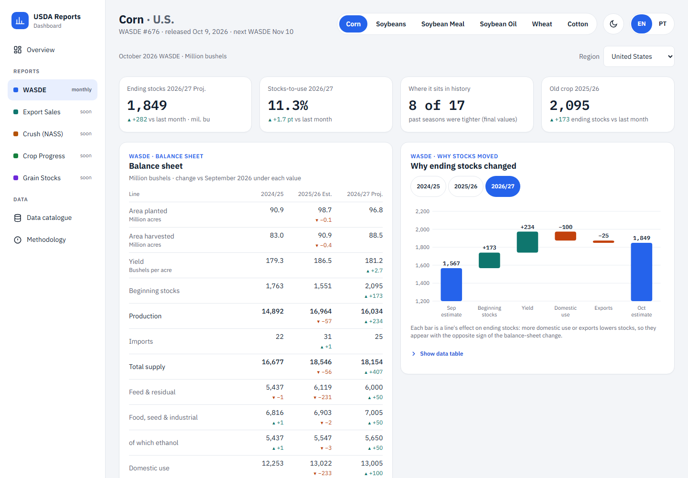 | 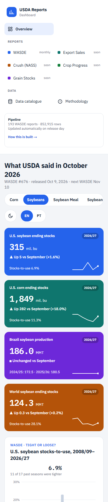 |
| **Data catalogue** (by report or commodity; sha256, schema version, `datapackage.json`) | **Dark mode** |
| 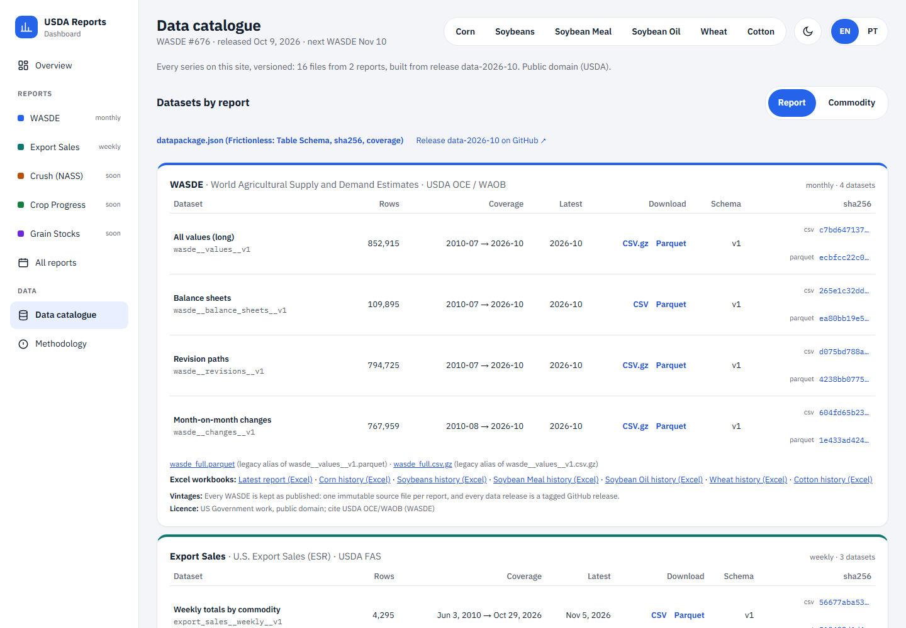 | 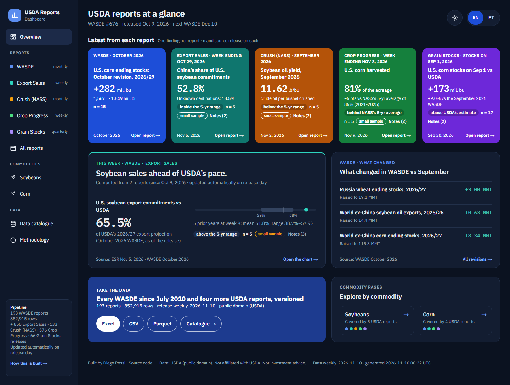 |
| **Export Sales, dark** | **Soybean crush, dark** |
| 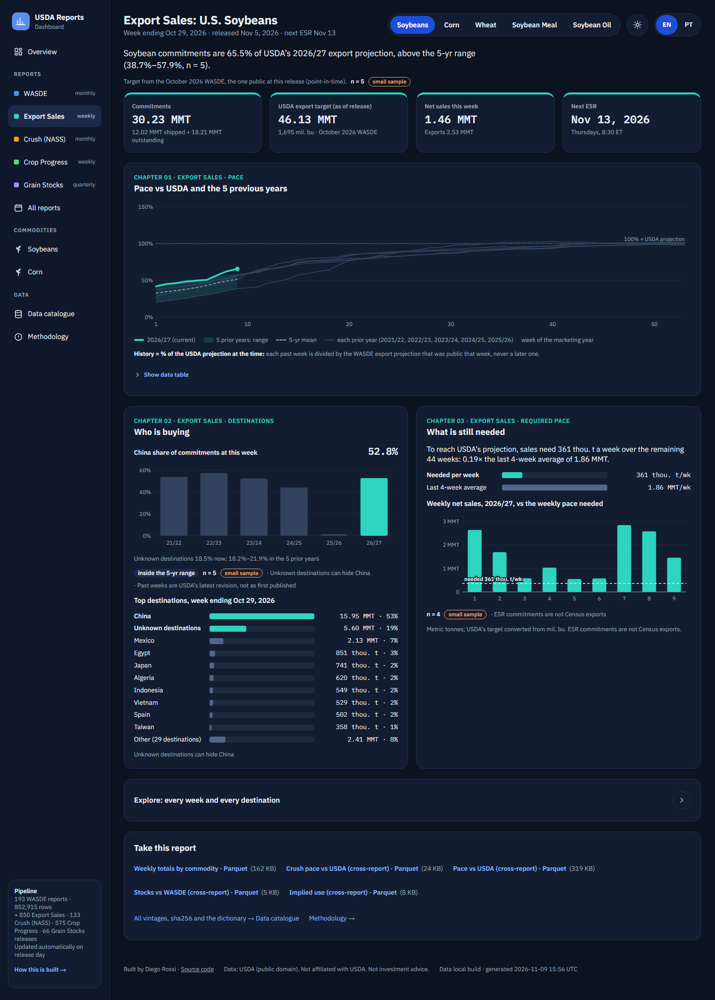 | 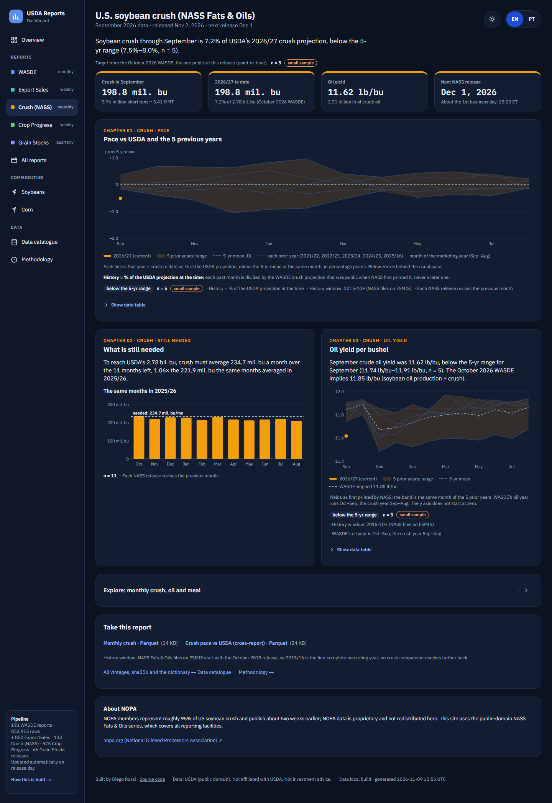 |
| **Crop Progress, dark** | **Grain Stocks, dark** |
| 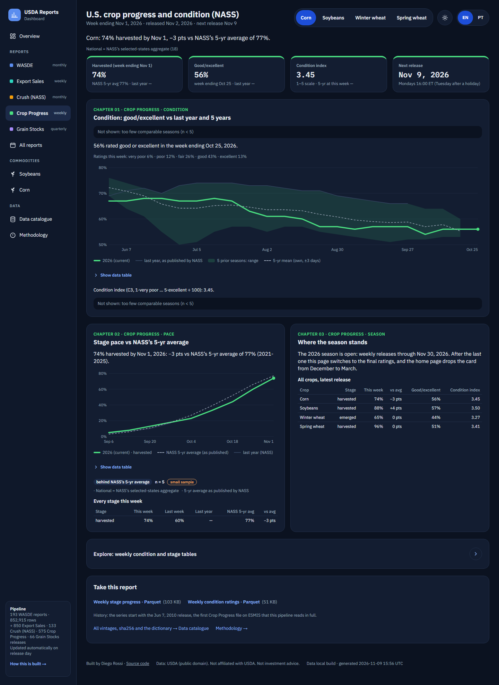 | 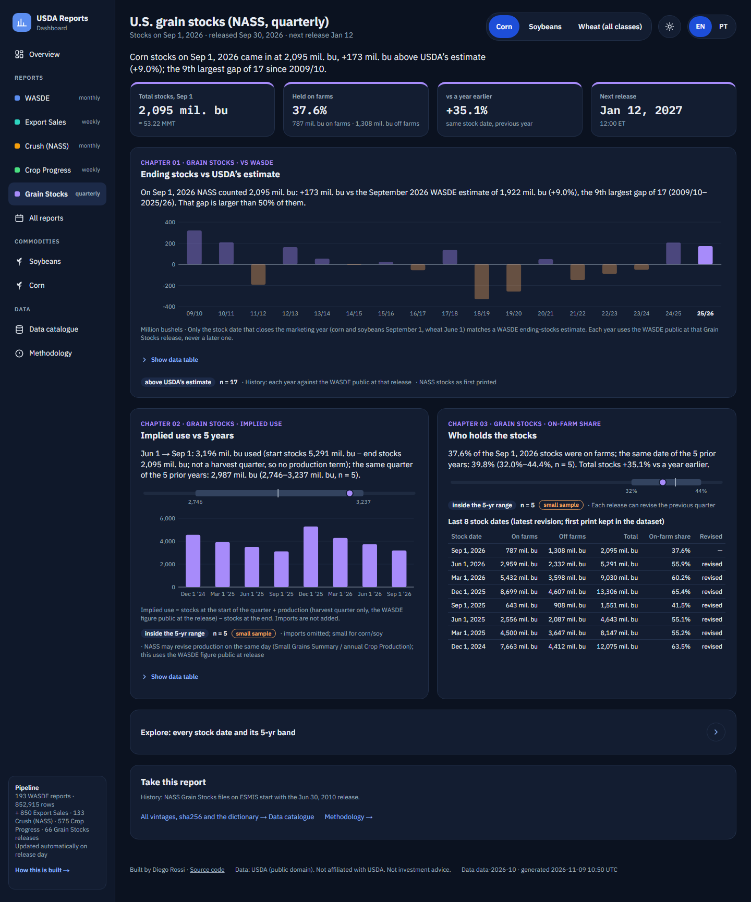 |
| **Soybeans: every report, dark** | **Crop Progress in Portuguese** |
| 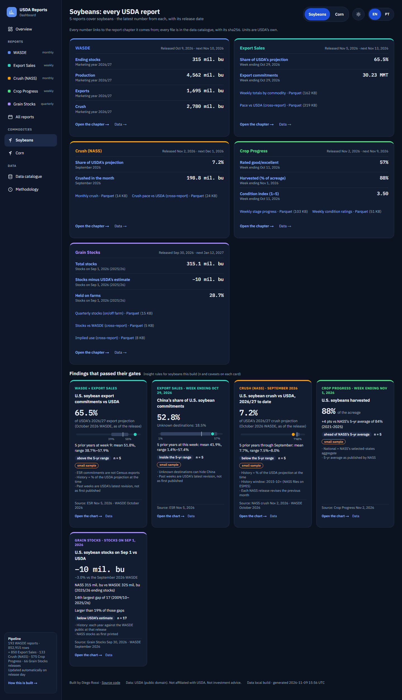 | 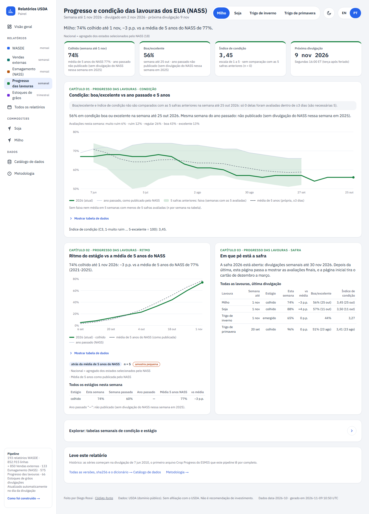 |

Screenshots are regenerated with `SHOTS_DIR=../docs/screenshots npx playwright test shots --project=desktop` (from `web/`).

## Project structure

```
.github/workflows/   ci.yml · release.yml (gate → detect → build → deploy → verify → release) · keepalive.yml
config/              reports.yaml (registry) · datasets.yaml · calendars/ · contracts/ · vocab/
                     reports/wasde/{mappings.yaml, focus.yaml, xml_layout/} · reports/export_sales/source.yaml
                     reports/oilseed_crush/source.yaml (verified table title, unit and row labels)
src/usda_reports/
  core/              settings, logging, HTTP, manifest v2, calendars, contracts, vocab, registry
  reports/           ReportSpec base · wasde/ (sources, CSV + XML parsers, XML layout, silver)
                     export_sales/ (ESR API client, ingest, snapshot change-log parser)
                     oilseed_crush/ (ESMIS zip ingest, soybean-table parser, vintages)
  nass_common/       ESMIS client (0-based paging, files[] URLs), zip fetch, NASS t/h/u/d CSV grammar
  insights/          rules W1–W4, E1–E3, F1–F3 · gates · hero/card selection · typed insights.json schema
  bronze/            raw store + bronze-store delta shards
  silver/            report-agnostic driver + common envelope
  gold.py            runs dbt
  publish/           highlights, web JSON/Parquet, Excel, versioned catalogue, datapackage,
                     catalog.json, Export Sales and crush page JSON, release/tag contract
  cli.py             `usda-reports` command
dbt/                 staging/{wasde,export_sales,oilseed_crush} · marts/{core,wasde,export_sales,oilseed_crush,cross} ·
                     seeds (dim_unit, dim_commodity, esr_corrections) · macros (assert_no_lookahead) · tests
web/                 Next.js 16 static site (ECharts, hyparquet, SheetJS), EN + pt-BR, Playwright tests
                     app/reports/{wasde,export-sales,oilseed-crush,crop-progress,grain-stocks} · app/commodities/[slug]
tests/               unit + integration (dbt + publish on real fixture data)
data/manifest.json   audit trail of every ingested release (schema v2; data lives in releases)
```

## Quality

- **Python:** ruff, mypy, pytest (unit + integration) including an end-to-end dbt + publish
  run on real fixture data, XML-vs-CSV reconciliation, the release/tag contract and Soy Outlook
  compatibility checks. A **parity gate** (`tests/integration/test_parity_wasde.py`, runs when
  the real bronze store is present) rebuilds everything from bronze and proves the result has the
  same rows and sorted-content hash as the published `wasde_full.parquet`.
- **dbt:** schema tests + singular tests (balance identity, unique keys, plausible stocks-to-use,
  monotonic WASDE numbers, complete latest report, no missing report months), enforced contracts
  on the ESR/cross marts, `assert_no_lookahead`, a same-timestamp ASOF boundary unit test,
  non-decreasing ESR accumulated exports (`esr_corrections` seed) and an ESR ↔ WASDE
  reconciliation warning (±10% on completed marketing years).
- **ESR without a key or network in CI:** recorded, trimmed API responses (`tests/fixtures/export_sales/`).
- **NASS crush without network in CI:** six recorded ESMIS zips (including the four-month 2015-10
  layout, the 2022-03 header typo and the 2025 shutdown release) and a slice of the gold marts
  (`tests/fixtures/oilseed_crush/`); a dbt unit test pins the crush ASOF boundary and
  `assert_no_lookahead` runs on the WASDE crush, WASDE oil and NASS-vintage timestamps.
- **Web:** ESLint, TypeScript, Playwright (desktop + mobile): smoke, axe in English and
  Portuguese, light and dark, on every route, 360px no-horizontal-scroll, and a copy-vs-JSON
  contract test for the lead card, its evidence and the home tiles, a home layout budget (one
  chart, about one screen at 1440px), a home layout contract (`home-layout.spec.ts`: tiles under
  the title, aligned values/footers and 7 | 5 rows, no half-empty card, 3 + 2 tiles at 1024/768px,
  app bar and drawer at 360px, light/dark, EN/PT), the Export Sales header, the crush, Crop Progress
  and Grain Stocks pages and the commodity pages, in EN and PT (plus the exact NOPA note and the
  verbatim G2 caveats); the Crop Progress off-season state is tested on a frozen-clock fixture.
  Re-run against the live site after every deploy. Until the first data release that carries
  the Crop Progress JSON, CI overlays a recorded cut-C set (`web/e2e/fixtures/cut-c/`) on the
  downloaded release; afterwards it tests the real files.
- **Charts:** colour palette validated for colour-vision deficiency and contrast in light and dark mode.

## Known limitations

- History starts in July 2010 (earlier reports are PDF/text only).
- Pre-2021 history excludes WASDE's projection-reliability tables and some quarterly
  livestock lines; the U.S. milk table's fat/skim blocks are not fully separated in the XML era.
- Projected prices published as ranges in older reports are stored as the range midpoint.
- No pre-report trade estimates (not public), so "surprise vs. the market" is out of scope.
- Values are as published by USDA (rounded); tiny changes can be rounding.
- Export Sales history before the first weekly capture is `latest_only`: the API returns
  today's revised values for old weeks. Release instants of backfilled weeks follow the weekly
  calendar rule (never earlier than the real publication, so no look-ahead).
- NASS crush history starts with the October 2015 ESMIS file (Quick Stats would reach further
  back; v2 backlog). Future crush release dates in `config/calendars/oilseed_crush.yaml` follow
  NASS's first-business-day pattern and are checked against the NASS calendar each December;
  detection itself always follows what ESMIS lists.
- ESR counts sales and shipments reported by exporters; WASDE exports follow Census trade data.
  The two differ (notably soybean oil and some wheat years); the reconciliation test warns, the
  pace insights carry the caveat.

## Author

**Diego Rossi** — Market Risk & Data Engineering · commodity markets, derivatives, agribusiness.

Data: USDA World Agricultural Outlook Board, USDA Foreign Agricultural Service and USDA
National Agricultural Statistics Service (public domain; see
[`docs/DATA_LICENSES.md`](docs/DATA_LICENSES.md)). Not affiliated with USDA.
